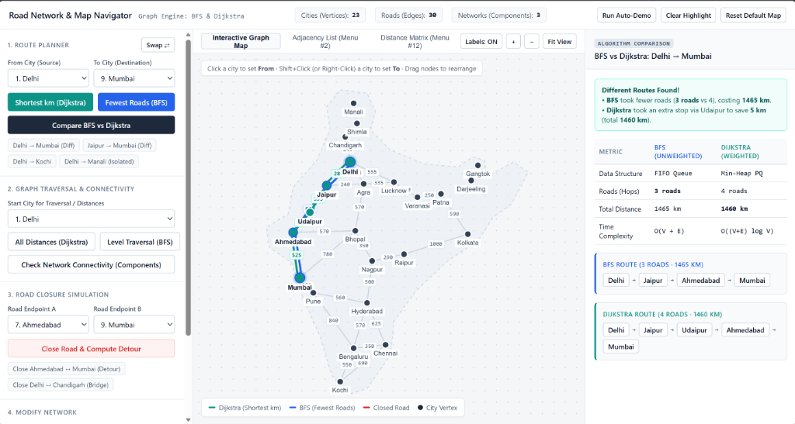

# Road Network & Map Navigator 🗺️

> An interactive graph algorithm engine and map visualizer modeling cities as vertices and roads as weighted undirected edges. Built with **C++** (Terminal Engine) and a **Modern Web UI** (Interactive HTML5 Canvas).



---

## 🌟 Key Features

- **Shortest Route by Distance (Dijkstra's Algorithm)**: Finds the path with the minimum total kilometres using a min-heap priority queue ($O((V + E) \log V)$).
- **Route with Fewest Stops (Breadth-First Search)**: Finds the path with the fewest road segments / hops using a FIFO queue ($O(V + E)$).
- **Side-by-Side Algorithm Comparison**:
  - Compares BFS vs Dijkstra on identical trips (e.g., Delhi $\rightarrow$ Mumbai: BFS chooses 3 roads / 1465 km, while Dijkstra chooses 4 roads / 1460 km).
  - Highlights where hop optimization differs from distance optimization.
- **Level-by-Level Graph Traversal (BFS)**: Visualizes radial hop waves and reachable depths from any chosen city.
- **Connected Components Detection**: Identifies separate, disconnected road networks (e.g. Mainland India, Himachal region, Eastern Hills).
- **Road Closure & Bridge Simulation**: Simulates real-time road closures, detects critical graph bridges, and dynamically computes Dijkstra detours.
- **Graph Editing**: Add new cities, connect two-way highways with custom weights, or inspect the direct adjacency list and distance matrix.

---

## 🏗️ Project Architecture

```
.
├── main.cpp          # Core C++ graph data structure & CLI menu (BFS + Dijkstra)
├── index.html        # Interactive UI layout (Controls, Canvas Map, Analysis Inspector)
├── app.js            # Frontend graph engine & interactive canvas renderer
├── style.css         # Modern, minimal slate UI theme
├── preview.png       # Application screenshot
├── decision.md       # Project design notes & algorithm summaries
└── .gitignore        # Git ignore rules for compiled binaries
```

---

## 🚀 How to Run

### 1. Interactive Web Visualizer (Zero Setup)
Simply open `index.html` in any web browser:
- **Windows (PowerShell)**:
  ```powershell
  Start-Process index.html
  ```
- Or double-click `index.html` directly in File Explorer.

### 2. C++ Terminal Engine
Compile and run the single-file C++ program with any standard C++14 compiler:
```bash
# Compile
g++ -std=c++14 main.cpp -o roadmap.exe

# Run interactive menu
./roadmap.exe

# Or run the automated demo test suite
./roadmap.exe demo
```

---

## 📊 Algorithms & Complexity

| Algorithm | Objective | Data Structure | Time Complexity |
|---|---|---|---|
| **BFS** | Fewest roads (hops), reachability, components | FIFO Queue | $\mathcal{O}(V + E)$ |
| **Dijkstra** | Shortest total distance (km) | Min-Heap Priority Queue | $\mathcal{O}((V + E) \log V)$ |

---

## 👤 Author
- GitHub: [@ronitrai27](https://github.com/ronitrai27)
